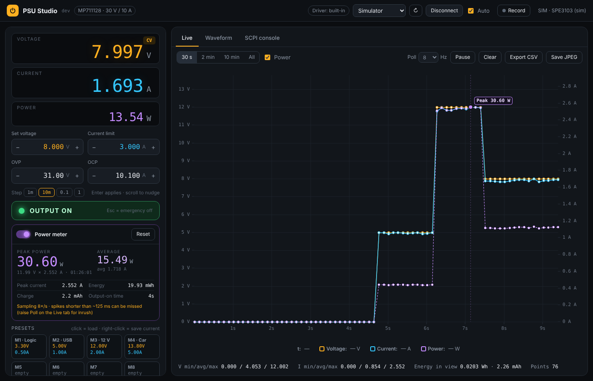
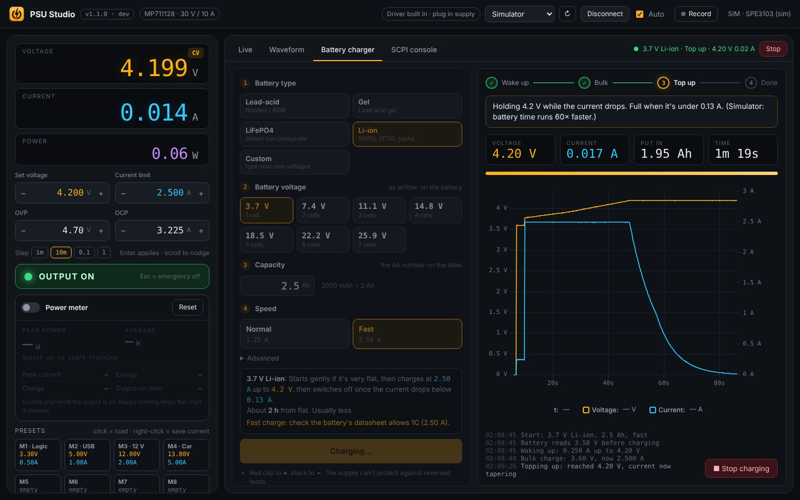

#  PSU Studio

[](https://github.com/NB6RULES/OBRA-powersupply/releases/latest/download/PSU-Studio.exe)
[](https://github.com/NB6RULES/OBRA-powersupply/releases/latest/download/PSU-Studio-linux-x86_64)
[](https://github.com/NB6RULES/OBRA-powersupply/actions/workflows/build-exe.yml)

Both buttons always point at the newest build. Single file, no install.

- **Windows:** [PSU-Studio.exe](https://github.com/NB6RULES/OBRA-powersupply/releases/latest/download/PSU-Studio.exe). Windows may show a SmartScreen warning because it isn't code-signed: click *More info → Run anyway*.
- **Linux (x86_64):** [PSU-Studio-linux-x86_64](https://github.com/NB6RULES/OBRA-powersupply/releases/latest/download/PSU-Studio-linux-x86_64). See [Run it (Linux)](#run-it-linux).



A cleaner control app for the **Multicomp Pro MP711127 / MP711128 / MP711129 / MP711130 / MP711131** bench supplies. These are rebadged OWON SPE units. The app talks to the supply over USB using SCPI (CH340 serial, 115200 8N1).

## What it does

- **Big live readouts** for V, A and W, with a CV/CC badge and a trip warning.
- **Setpoints**: set voltage, current limit, OVP and OCP. Type a value and press Enter, use the +/− buttons, or Ctrl+scroll. Step size is selectable.
- **Output button**, plus **Esc as an emergency off**. Esc also stops a running waveform.
- **Power meter**: switch it on to track, while the output is on:
  - peak power, with the voltage, current and time it happened
  - average power and average current (time-weighted)
  - peak current, energy (Wh), charge (mAh) and output-on time
  - It flashes **NEW PEAK** when the record is beaten, and marks the peak on the live chart and in JPEG exports. It keeps counting while the chart is paused. Reset starts a new measurement.
  - Short spikes (inrush) can be missed between readings: raise Poll to 15 Hz to catch more.
- **8 presets**. Click one to load it. Right-click to save the current settings into it.
- **Live chart** with 30 s / 2 min / 10 min / all views and drag-to-zoom. It shows min/avg/max, energy in Wh and charge in mAh, and you can export the data to CSV.
- **Logging and export**:
  - **Record** writes every reading straight to `Documents\PSU Studio\logs\log_<date>.csv` as it arrives, so long runs are safe even if the app closes.
  - **Export CSV** on the Live tab saves everything collected since you connected (or pressed Clear).
  - Both CSVs have columns: timestamp, time_s, voltage_V, current_A, power_W, set_V, set_A.
  - **Save JPEG** on the Live and Waveform tabs saves the chart as a high-res image, with a title, stats, legend and date.
- **Waveform editor**:
  - Edit steps in a spreadsheet-style table (V, A, seconds, on/off), with a stepped preview and a play-head while it runs.
  - **Paste a lookup table**. Ctrl+V anywhere on the Waveform tab, or use the button. It accepts cells copied from Excel, CSV, tab-separated or space-separated text, and decimal commas.
  - **Import Excel/CSV**: .xlsx, .xlsm, .csv, .tsv, .txt. You can pick the sheet, or drag and drop a file onto the window.
  - Column mapper:
    - Assign each column a role: Time (absolute), Step duration, Voltage, Current, or Enabled. The roles are auto-guessed from the headers.
    - Pick units: s / ms / min, V / mV, A / mA.
    - Optional **resample** to an even step size, for dense LUTs.
  - **Generator** for sine, triangle, square, ramp, sawtooth and staircase waveforms.
  - Run options: loops (0 = forever), from/to step, and auto output on/off.
- **Battery charger** tab: turns the supply into a proper staged charger.
  - Pick the type (lead-acid flooded/AGM, gel, LiFePO4, Li-ion, or Custom), the voltage written on the battery (6 / 12 / 24 V, 12.8 V lithium, 3.7 V cells…), the Ah from the label, and Normal or Fast. The app works out the charge current and voltages.
  - Stages: gentle wake-up for a very flat battery, bulk (constant current), top-up (constant voltage while the current tapers), then **hold at float** for lead-acid (safe to leave connected) or **switch off** for lithium.
  - Typical 12 V lead-acid: charges to 14.4 V, then holds 13.65 V. Custom mode lets you type your own voltages, e.g. a plain 13.8 V maintainer.
  - Safety stops (output off): battery reads the wrong voltage for what you picked, no current flowing (no battery / loose clip), voltage above target, the supply tripping, lost comms, and a time limit.
  - Live chart of the charge, Ah put in, elapsed time and an event log. Esc still stops everything.
- **SCPI console** with command history.
- **Built-in driver install**:
  - The top bar shows the CH340 driver status.
  - "Install driver" runs the bundled installer with the Windows admin prompt.
  - The app then watches for the supply and connects automatically.
- **Simulator** so you can try everything without the supply.

## Run it (Windows)

1. Install Python 3.12 or 3.13 from python.org.
2. Double-click `run.bat`. It installs the 3 packages the first time.
3. To try it without hardware, double-click `run_simulator.bat`.

## Run it (Linux)

```sh
chmod +x PSU-Studio-linux-x86_64
./PSU-Studio-linux-x86_64          # add --sim to try it without the supply
```

- It opens in its own window if Chrome, Chromium, Edge or Brave is installed, otherwise in your default browser. Closing the window quits the app.
- No driver needed: Linux has the CH340 driver built in.
- **"No USB permission":** click **Fix USB access** in the top bar. It asks for your password once and installs a udev rule (`/etc/udev/rules.d/70-psu-studio.rules`) that gives the logged-in user access to the supply. Unplug and replug if it still complains. Without a graphical password prompt (pkexec), run instead: `sudo usermod -aG dialout $USER`, then log out and back in.
- **"USB blocked by BRLTTY"** (common on Ubuntu): the braille-display service grabs the CH340 chip so no serial port appears. If you don't use a braille display: `sudo apt remove brltty`, then replug the supply.
- Built on Ubuntu 22.04, so it needs glibc 2.35 or newer (Ubuntu 22.04+, Debian 12+, Fedora 36+ and similar). It updates itself like the Windows version.
- From source instead: `./run.sh` (Python 3.10+).

## Build the .exe yourself

Every push to `main` builds the Windows exe and the Linux binary on GitHub Actions, smoke-tests the Linux one, and publishes both as the latest release (the download buttons above). To build locally instead:

1. Put the CH340 driver installer in `drivers\`. This is the `CH341SER.EXE` or `CH34x_Install_Windows_v3_4.EXE` from the Multicomp zip.
2. Double-click `build.bat`.
3. The output is `dist\PSU Studio.exe`. That one file has the UI, the driver installer and everything else. Copy it anywhere.

If `drivers\` is empty, the Install driver button opens WCH's official download page instead.

## Charging batteries: read this



- **Polarity:** red clip to +, black to −. The supply can't protect against reversed leads.
- **Stay nearby.** The app can't sense battery temperature. Stop if the battery gets hot, swells or smells.
- **Lithium packs** with more than one cell need their own BMS / balance board. The app only sees the total pack voltage.
- **Back-feeding:** when the output is off, a connected battery can push current back into the supply. If you leave batteries connected for a long time, a blocking diode or ideal-diode module in the + lead protects the supply (the diode drop slightly lowers the charge voltage).
- The charge figures are typical values. If the battery's datasheet says something different, use **Custom** with its numbers.
- The simulator includes a pretend battery whose time runs 60× faster, so you can watch a full charge in a minute or two.

## Notes

- Waveforms are timed by the PC, not by the supply. The SPE series has no list mode over SCPI. Steps under 50 ms get stretched to 50 ms. For dense lookup tables, use "Resample to 0.1 s".
- Close the Multicomp software first. Only one program can hold the COM port at a time.
- The version and build number are shown next to the app name in the top bar (click it to check for updates) and in the .exe's Properties → Details.
- The app icon lives in `app/assets/`. To change it, edit `tools/make_icon.py` and run `python tools/make_icon.py app/assets`, then copy `favicon.png` into `app/web/`.
- Settings and the last waveform are saved to `Documents\PSU Studio\settings.json`.
- If the desktop window won't open (very old Windows without WebView2), run `run.bat --browser`. It opens the same UI in your browser.
